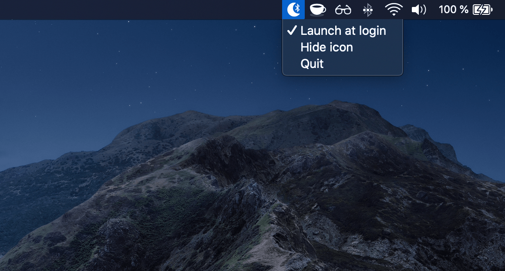

# Bluesnooze

[Download the latest release][download-latest] or install via Homebrew:

```sh
brew install bluesnooze
```

Please note the latest release requires MacOS Monterey (12.0) or higher.

## Enjoying Bluesnooze? ❤️

Perhaps you could [buy me a coffee](https://www.buymeacoffee.com/odlp) to say thanks :coffee:

## About

**Bluesnooze prevents your sleeping Mac from connecting to Bluetooth accessories.**

If you pair Bluetooth headphones or speakers with both your phone & Mac it can be frustrating when your sleeping Mac connects intermittently and disrupts the audio.

With Bluesnooze the Bluetooth connection is switched off when your Mac sleeps, and switched on when your Mac wakes.

Alternatively, Bluesnooze can leave Bluetooth switched on and **only disconnect the devices you choose** when your Mac sleeps. See [Disconnecting only selected devices](#disconnecting-only-selected-devices).



You might also want to check-out Whisper –  [the volume limiter for MacOS](https://apps.apple.com/gb/app/whisper-volume-limiter/id1438132944?mt=12).

## Installation

1. Download `Bluesnooze.zip` from the [latest release][download-latest]
1. In Finder, open `Bluesnooze.zip` in your `Downloads` directory
1. Drag `Bluesnooze.app` to your `Applications` directory
1. *Optional*: Configure 'Launch at login'

## Disconnecting only selected devices

Switching Bluetooth off entirely stops Find My from locating your sleeping Mac, and breaks "Unlock with Apple Watch". To avoid that:

1. Click the Bluesnooze icon and choose **Only disconnect selected devices on sleep**
1. Open **Devices to disconnect** and tick the paired devices (e.g. your headphones) you want released when the Mac sleeps
1. *Optional*: tick **Reconnect devices on wake** to reconnect those devices when the Mac wakes

In this mode Bluetooth stays powered on. When the Mac sleeps the selected devices are disconnected, and if one of them reconnects while the Mac is asleep (e.g. during a dark wake) it is disconnected again. Other devices are untouched. **Turn off all Bluetooth on sleep** keeps the original behaviour and is the default.

## Caveats

- In the default "Turn off all Bluetooth" mode this app is not compatible with the “Allow your Apple Watch to unlock your Mac” feature. Use the selected-devices mode above instead.
- Selected-devices mode is best-effort: it can only ask macOS to drop the connection, so a device that reconnects while the Mac is fully suspended can't be intercepted until the Mac next runs.
- Unfortunately this app can't be distributed via the App Store because it uses a private API to switch Bluetooth on/off (but the release version is notarized by Apple).

[download-latest]: https://github.com/odlp/bluesnooze/releases/latest

## FAQs

### Can I disconnect only certain devices, instead of switching Bluetooth off?

Yes, see [Disconnecting only selected devices](#disconnecting-only-selected-devices).

### How can I hide the Bluesnooze icon?

In your terminal run the following command:

```sh
defaults write com.oliverpeate.Bluesnooze hideIcon -bool true && killall Bluesnooze
```

When you next relaunch the application there should be no icon in the menu bar.

### How can I restore the Bluesnooze icon?

In your terminal run the following command:

```sh
defaults delete com.oliverpeate.Bluesnooze hideIcon && killall Bluesnooze
```

When you next relaunch the application it should appear in the menu bar.
